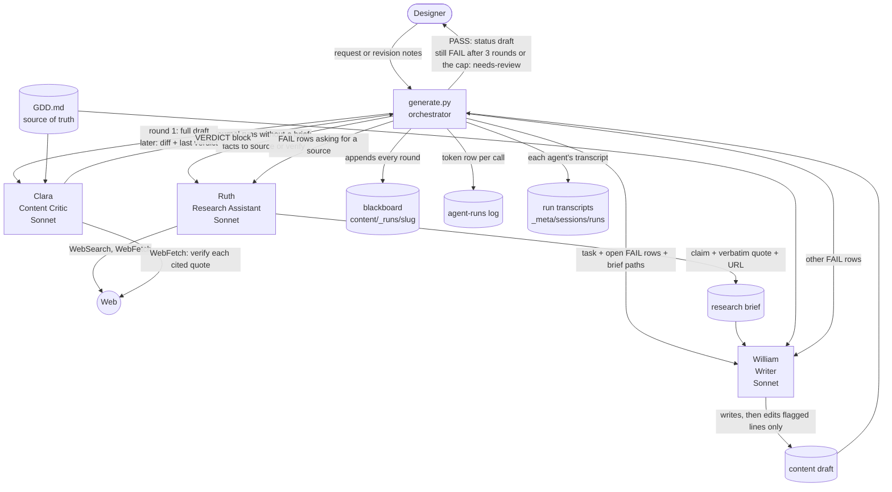

# Content crew for Chill Bee Game

**Game:** *Chill Bee Game*, a cozy mobile beekeeping idle game (Godot, iOS and Android, English and French). The player restores a magical pocket world: harvesting honey by hand, automating the farm, expanding through four biomes, and recording native bee species in a Bee Journal. The full design is in [GDD.md](GDD.md).

**What this crew produces:** game-ready player text in English and Canadian French, written from the GDD and checked against it: the guide character's onboarding script, the four biome unlock intros, and Bee Journal entries for the game's native bee species. Real-world bee facts come with a source and verbatim quote; fictional species get invented lore that fits the GDD.

## The crew

Three agents coordinated by a Python orchestrator. Each agent is a Claude Code subagent definition in `.claude/agents/`, run headless with `claude -p --agent <name>` (no API key needed). The orchestrator is raw Python, standard library only: [_tools/generate.py](_tools/generate.py).

<!-- generated: crew-agents (python -I _tools/sync_docs.py; do not edit by hand) -->
| Agent | Model | Tools | What it does |
|---|---|---|---|
| **Ruth**, Research Assistant ([definition](.claude/agents/research-assistant.md)) | Sonnet | Read, Grep, Glob, Write, WebSearch, WebFetch | Finds and verifies real-world sources for Chill Bee Game, returning each claim as narrowly as its verbatim quote supports, with the URL, source kind and date checked, and a list of what could not be sourced. |
| **William**, Writer ([definition](.claude/agents/writer.md)) | Sonnet | Read, Grep, Glob, Write, Edit | Writes Chill Bee Game story outlines from an idea for a story point, lesson or goal, and drafts the Bee Journal's real-world facts in English and French from Ruth's research briefs. |
| **Clara**, Content Critic ([definition](.claude/agents/content-critic.md)) | Sonnet | Read, Grep, Glob, WebFetch | Checks William's Chill Bee Game drafts against GDD.md for lore, tone and glossary, child safety and spending, facts and French, and cited sources, and replies with a PASS or FAIL verdict block that the script appends to the run's blackboard. |
| `generate.py` (orchestrator) | — | — | Runs the loop, controls the blackboard, logs every call and keeps each call's transcript. |
<!-- /generated: crew-agents -->

Clara and Ruth were themselves written by a fourth agent, **Martin**, the Hiring Manager ([definition](.claude/agents/hiring-manager.md)), from the workspace's agent template.

## How they coordinate



One run, step by step:

1. **Ruth** (Journal runs with no brief yet; `--no-research` skips her, e.g. for fictional species) writes a brief: every claim as narrow as its quote ("some", not "all"), at most 6 searches and 12 fetches. On a new run she researches the request; on `--revise` she verifies the claims the draft already makes.
2. **William** writes the draft from the GDD and the brief. He does no research of his own: a fact no brief supports stays out of the text.
3. The orchestrator copies the draft onto the run's **blackboard**: the full draft in round 1, only a diff after that.
4. **Clara** gets the request and the draft (or her last verdict and the diff) in her prompt and runs five checks: lore against the GDD, tone and Glossary terms, child safety and spending pressure, facts and French, and cited sources. She fetches every cited URL herself rather than trusting the brief. She replies with `VERDICT: PASS` or `FAIL`, a "Checked" list showing her evidence, and a findings table citing the GDD.
5. **FAIL** goes back round the loop: rows asking for a better source go to Ruth first, the rest to William, who edits only the flagged lines. **PASS** ends the run with `status: draft` for the designer to approve. After 3 rounds the draft is kept as `needs-review`, and so is a run that has spent its token cap (500,000 by default, `--max-tokens`). The cap is checked after each FAIL, before a new round starts, so a run can finish above it: one round can cost more than the cap's remainder.

**The blackboard.** `content/_runs/<slug>/blackboard.md` is the shared record of one run: the request, research used, each round's draft or diff, every verdict, and a token table. The orchestrator is its controller: it hands each agent only the slice it needs in the prompt, so no agent re-reads the whole history every turn.

**Provenance and decisions.** Each output's frontmatter records its author, type, status and the blackboard it came from. The designer's decision is two more fields, `decided:` and `decision:`, which agents never read; `python -I _tools/index.py --decisions content` lists them.

**Not crashing.** A failed agent call marks the blackboard `result: failed` and logs what was spent; a fresh run can replace it. A finished run is never overwritten.

**Records.** Every agent call is logged to `_meta/agent-runs.md` with two token measures: *total processed* (summed over the call's turns) and *final context* (the conversation's size at its last turn). Each call's own transcript is moved into `_meta/sessions/runs/<date>-<slug>-<run>/`, kept on the machine and out of git, and the blackboard links to it.

## Run it

Requires Python 3.10+ and the Claude Code CLI, logged in.

```
# new content
python -I _tools/generate.py biome-intros --type story --request "The intro text shown when the player unlocks each biome..."
python -I _tools/generate.py bee-journal-magic --type journal --no-research --request "Bee Journal entries for the fictional species..."

# revise an existing draft (with or without designer notes)
python -I _tools/generate.py onboarding-script --revise --request "Scrap the 'honey money' line; celebrate the first sale."

# check the critic still catches known errors (exit 0 = all caught)
python -I _tools/critic_check.py

# test the orchestrator, critic check, run logger, decision page and doc checks with fake agents: no Claude account, no tokens
python -I _tools/test_generate.py
```

## What it has produced

| Output | Result | Tokens |
|---|---|---|
| [Onboarding script](content/onboarding-script.md): the guide's first-session script, three guide personalities offered since the GDD leaves the guide TBD | PASS, then revised for the designer's note ("honey money" line replaced; only 3 lines changed) | 221k + 195k |
| [Biome intros](content/biome-intros.md): title card and guide lines for Sunny Meadow, Alpine Valley, Enchanted Grove, Cloud Gardens | PASS in round 1 | 301k |
| [Bee Journal, fictional species](content/bee-journal-magic.md): Lantern bee, Glowcap digger, Drift bee, Stardust bee | FAIL, fixed, PASS in round 2 | 352k |
| [Bee Journal, real species](content/bee-journal-real.md): sweat, leafcutter, bumble, mason and mining bees | Run 1 (William researching alone): FAIL, stopped at the token cap. Run 2: Ruth, on Haiku, verified the draft's claims ([brief 1](research/bee-journal-real.md)); Clara failed 5 rows; stopped at the cap. Run 3, with the designer's notes: William trimmed every fact to its brief quote; Clara failed 5 rows; Ruth, back on Sonnet, sourced them ([brief 2](research/bee-journal-real-2.md)); William fixed them; PASS in round 2 | 879k, 503k, 1,170k |

Token figures are *total processed*. Every run's full record is in `content/_runs/`; every agent call is in [_meta/agent-runs.md](_meta/agent-runs.md).

## Does it sound like the game?

Mostly yes, because nothing is written from a blank page. William reads the GDD's Story Premise & Onboarding, Aesthetic & Tone, Child Safety and Glossary sections, plus the ones the request touches, before every draft. Clara checks each line against those same sections. The text uses the game's own world, objects and words, not generic fantasy-farm filler:

- **The game's own places and honeys.** Each biome intro names the hive and honey the GDD gives that biome: *"Your classic wooden Langstroth hive is ready and waiting"* (Sunny Meadow), *"cosy chalet hives"* (Alpine Valley), *"hanging hives that sway gently"* (Enchanted Grove), and the honeys *Wildflower Gold Honey*, *Frosted Fireweed Honey* and *Moonlight Nectar*. Clara's Tone & Glossary check confirmed each honey name against the Glossary and the biome table ([blackboard](content/_runs/biome-intros/blackboard.md)).
- **The "playful, whimsical, and cozy" tone the GDD sets (Aesthetic & Tone).** Title cards like *"A tiny pocket world, a hive full of possibility, and a meadow just waiting to hum."* keep to the GDD's pocket-world premise, and Clara checked the register of every guide line.
- **Fictional lore that fits the magic biomes.** *"Lantern bees carry a tiny ember of Moonlight Nectar inside their thorax, casting a warm amber glow…"* ties the invented species to the Enchanted Grove's honey and its glowing mushrooms. The real species, by contrast, say only what a cited source says.
- **Where the designer still stepped in.** The onboarding script passed Clara, but its *"honey money"* line didn't sound right to the designer and was replaced in a revision run. The Bee Journal wording got the designer's corrections before approval. The critic keeps the text consistent with the GDD; the designer still has the final say on voice.

## What the critic caught

- **Fictional Journal, round 1** ([blackboard](content/_runs/bee-journal-magic/blackboard.md)): two French errors. *"spores bioluminescent**s**"* (spore is feminine), and a French sentence that said *"the magic of pollination"* where the English said *"the grove's magic"*. Round 2's diff changed only that paragraph, and Clara passed it.
- **Real-species Journal, round 1** ([blackboard](content/_runs/bee-journal-real/blackboard.md)): she fetched all eight cited pages and failed four facts whose source did not say what the draft claimed, e.g. *"all nesting in tiny burrows underground"* when the cited canada.ca page says some sweat bees nest in wood. This run is why research moved to Ruth: William researching alone took 34 turns and 720k tokens and still overclaimed.
- **Known-bad onboarding draft** ([blackboard](content/_runs/onboarding-regression/blackboard-2.md)): a false bee fact (*"Without bees, the flowers can't bloom"*), a wrong cost claim (*"cheapest"* upgrade, when the GDD prices another lower), and a wrong GDD section number. William fixed exactly those lines in round 2.
- **What it missed at first.** The first version of Clara passed that same draft with an empty findings table ([blackboard](content/_runs/onboarding-script-v1/blackboard.md)). Her facts check only covered cited facts, she trusted the draft's claim that it had none, and a PASS needed no evidence. Her rules were tightened (check every line for real-world claims, a required "Checked" list, a sources check), and the draft became a permanent test: [_tools/critic_check.py](_tools/critic_check.py) re-runs it whenever her model or rules change.
- **The test catching a regression.** After later rule changes (she now receives her input in the prompt instead of reading the blackboard, and gained rules for fictional species and GDD conflicts), the first `critic_check.py` run on 2026-11-01 found she still caught the "cheapest" upgrade and the §9 citation but **missed the false bloom fact**. The check exited with code 1, as designed. A second check, with her reply saved, caught the bloom fact but missed the "cheapest" upgrade. Each run caught 2 of the 3 known errors, a different miss each time, which points to run-to-run variation rather than a broken rule. The weak spot was a game-fact claim in a table, so her Lore check now covers game facts wherever they appear, including tables and notes.

## Limits

- Ruth ran for real on the real-species Journal, end to end: brief, William writing from it, Clara verifying every quote, Clara's source FAILs sent back to Ruth for a second brief, then PASS. Research is expensive: William's two calls in that run took 706k tokens, mostly re-reading both briefs every turn.
- Ruth briefly ran on Haiku to save tokens. Her Haiku brief called eight claims "all supported" while its own notes said otherwise, and ignored the brief template; she is back on Sonnet, and the second (Sonnet) brief followed the template exactly.
- Clara's critic check varies run to run: both 2026-11-01 runs missed one of the three known errors (see above), and the 2026-11-08 run, after her Lore check was widened to cover game facts in tables, caught all three ([verdict](_tools/fixtures/onboarding-bad.last-verdict.md)). One clean run does not prove the miss is gone; the team's model-review rule ([_meta/team.md](_meta/team.md), Model reviews) treats repeated misses as the signal to revisit her rules or model.
- *Total processed* tokens include cached re-reads: each turn re-sends the whole conversation, and a single turn costs about 12,000 tokens before any work. The same run measured by *final context* is several times smaller (Martin's run hiring Clara: 234,632 total processed, 39,232 final context). Which measure counts against the Claude plan's limits is not published.
- Transcripts were kept only from the evening of 2026-11-01; earlier runs have their blackboards and log rows but not the agents' own turns.
- Every draft still needs the designer's approval, and real-world Journal facts need a conservation partner's review before launch.
