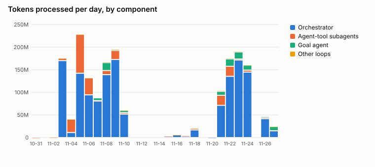
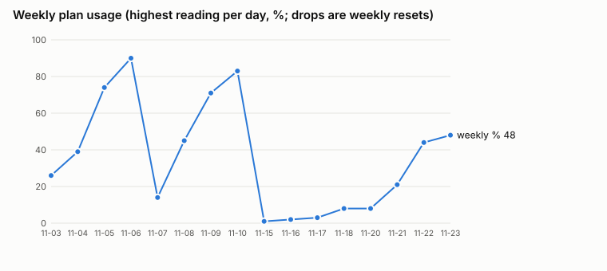
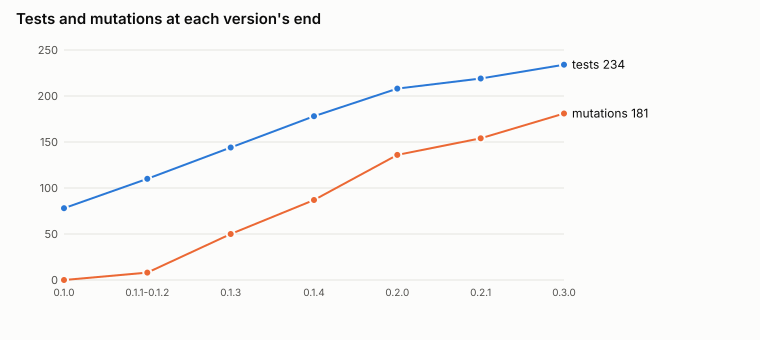
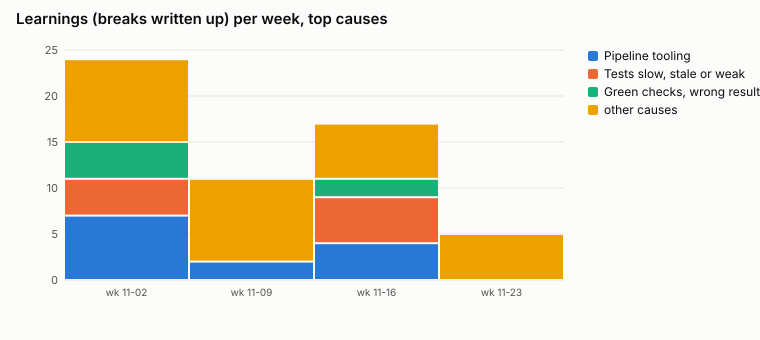
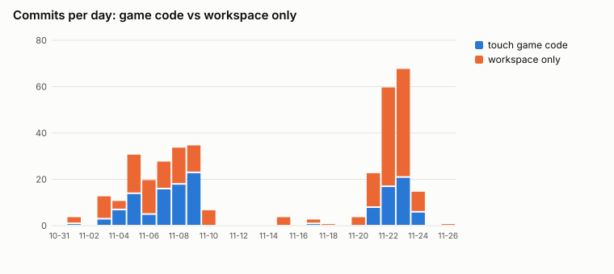

# Chill Bee Game: pipeline audit and cost analysis

Assignment 7, deliverable 3. Data as of 2026-11-22.

Sources: `_meta/agent-runs.md` and `agent-runs.csv` (765 runs), `_meta/learnings.md` (L1–L52), `_tools/audit_data.py` (every per-version, per-day and per-week number, regenerated with one command into `data.md`, `data/` and `charts/`), `GOAL_AGENT.md`, `STYLE_LOOP.md`, `CREW.md`, `game/reports/goal/0.3/blackboard.md`, git history.

## 0. Summary

Chill Bee Game is a cozy mobile beekeeping idle game built by one developer who designs and directs, and a crew of AI agents who write the code, scenes, tests, content and documentation. Between 2026-10-14 and 2026-11-22 the pipeline produced the game design document (GDD), seven playable versions (0.1.0 Harvest through 0.3.0, the course build, play-tested and tagged on 2026-11-22), bilingual Bee Journal content, and the tooling that runs it all: 319 commits, 765 logged agent runs, 234 automated tests and 181 mutation checks.

This audit looks at what that pipeline costs, in tokens and in time, where it fails, and what to change. It draws on the run log (`_meta/agent-runs.csv`), the 52 failure write-ups in `_meta/learnings.md`, the three loop write-ups (`CREW.md`, `STYLE_LOOP.md`, `GOAL_AGENT.md`), the 0.3 goal run's board, and git history.

**Three findings.**

1. **The orchestrating main session is most of the cost.** The 71 logged main sessions processed about 1.15 billion tokens, roughly 79% of everything logged after the workspace restructure. All the agents together processed about 311 million. Almost all of the main session's tokens are cache reads: every call re-reads a context of 100,000 tokens or more, so the turns spent waiting on and around an agent run often cost more than the run itself.
2. **The 5-hour window is the limit that binds, not the weekly one.** In the one batch measured in both, the work took 21% of a 5-hour window but only 3% of the week. Work is limited by how much fits in a sitting, which pushes the pipeline toward runs that can pause and resume.
3. **As the workspace grew, time, not tokens, became the constraint.** In the week of 2026-11-17, workspace files (tools and docs) grew about seven times faster than game code. On 2026-11-22 the 0.3 goal run stopped for the designer 20 times, and 11 of the first 19 needed no decision. The same day spent about 106 minutes waiting on test and build scripts.

**What works.** Headless agents given only a slice of the spec cost five to eight times less per call than the same agents run as interactive subagents (Patricia: 161k tokens per goal-agent call against 1.25M per subagent run). Moving script execution to a Haiku runner (Rex, 92k tokens per run) took test runs off the Sonnet agents. Each loop has a script check before its AI critic, so a mechanical failure costs no agent call.

**What to change.** Default every stop the workspace can already answer (built on 2026-11-22: placeholder visuals, style-guide minimums applied automatically, earlier answers carried forward, empty questions ignored). Freeze new tooling near deadlines. Shrink the orchestrator's context: route waiting and upkeep to a cheaper operator session and start a fresh session for each milestone. Measure usage more precisely before trusting any budget figure in this document to better than ±30%.

## 1. The pipeline at a glance

### 1.1 The design loop

Every change follows one loop, written down in `CONTEXT.md`:

1. **Request.** The designer asks for a feature, a fix or content.
2. **Proposal.** An agent writes a proposal on its shelf (`proposals/<role>/`), with a status line. Gerard (gameplay architect) writes feature proposals that trace the effect on every other system. Terry (progression) models the numbers.
3. **Decision.** The designer accepts, revises or rejects. Nothing reaches `GDD.md` until the designer has accepted it. This is the workspace's one hard rule.
4. **Apply.** The accepted proposal is written into the GDD, then into a build spec (`game/specs/<version>.md`): numbered changes, the config keys each one needs, and a test contract.
5. **Build.** The goal agent (`_tools/goal_agent.py`) builds the spec goal by goal with Patricia (scripts), Bob (scenes) and Quinn (tests).
6. **Check.** Scripts run the test suites, mutation tests, screenshot scripts and the style loop. Rex, a Haiku agent, runs every Godot script.
7. **Play-test.** The designer plays the build. What they find becomes the next spec's play-test lines.

### 1.2 The crew

| Agent | Role | Model | Writes to |
|---|---|---|---|
| Gerard | Gameplay architect: feature proposals across systems | Opus | `proposals/design/` |
| Terry | Progression and economy numbers | Opus | `proposals/balance/` |
| Connie | Compliance: kids, ads, purchases, data | Sonnet | findings reports |
| Patricia | Programmer: GDScript | Sonnet | `game/scripts/` |
| Bob | Builder: Godot scenes | Sonnet | `game/scenes/` |
| Quinn | QA and build: tests, reports | Sonnet | `game/tests/`, `game/reports/` |
| Rex | Script runner: runs tests, builds, mutations, shots | Haiku | replies only |
| Milo | Modeler: colorbox prop variants | Haiku | `game/scenes/variants/` |
| Vera | Style critic: judges screenshots against the style guide | Sonnet | verdicts on run boards |
| William | Writer: story, onboarding, Bee Journal (EN/FR) | Sonnet | `content/` |
| Clara | Content critic: checks drafts against the GDD | Sonnet | verdicts on run boards |
| Ruth | Research: sourced claims with verbatim quotes | Sonnet | `research/` |
| Andrew | Audio curation | Haiku | `audio/` |
| Martin | Hiring manager: writes new agent definitions | Haiku | `.claude/agents/` |
| Doris | Doc auditor: end-of-day doc check, read-only | Sonnet | findings |
| Oscar | Operator: routes the day's work, waits, does upkeep | Sonnet | `operator/` |

Above them sits the **orchestrator**: the developer's main Claude Code session, on Opus. It briefs agents, reads their results, edits specs and tools, and talks to the designer. Models are chosen per role (`_meta/team.md`, with the reason for each). Opus goes where errors compound across systems or numbers, Haiku where the output has a fixed shape and a later check catches misses, and Sonnet everywhere else.

### 1.3 The four loops

Each loop pairs a cheap script check with an AI critic, and writes one shared run board (`_templates/blackboard.md`).

- **Content loop** (`_tools/generate.py`, `CREW.md`). William drafts, `voice_check.py` checks glossary terms and cited GDD sections by script, then Clara scores lore, tone, child safety, facts and French, and cited sources. A FAIL goes back to William with her rows, for up to three rounds. Ruth supplies sourced facts for the real-species Journal.
- **Style loop** (`_tools/style_loop.py`, `STYLE_LOOP.md`). Godot renders the scene, `style_check.py` checks the palette and shape rules by script, and Vera judges the shots against the style guide's critic rules. Bob fixes her rows on a sandbox copy, under a motion guard and a unit-test gate, and the run ends with a patch for the designer. The voice half (William and Clara) uses the same structure for text.
- **Goal agent** (`_tools/goal_agent.py`, `GOAL_AGENT.md`). It parses a spec into goals, scans the game for evidence of each, scores the gaps, and builds the top goal with fresh headless agents given only their slice of the spec. Checks follow, then up to two fix rounds, then a checkpoint commit, then the next goal. All the reasoning up to "what to build next" is plain Python and spends no tokens.
- **Script running** (Rex). Every Godot test, build, mutation and screenshot run goes through Rex, enforced by a shell guard (`guard_shell.py` rule 7). Rex reports counts and the first error lines and changes nothing.

### 1.4 How agent output reaches the engine

Nothing an agent writes is reformatted by hand on its way into Godot:

- **Specs to code.** A spec names its config keys, scene nodes and tests. Patricia writes a node handoff (`game/specs/<version>-node-handoff.md`) listing every node Bob must add, and `contract_check.py` checks that every node a script looks up exists in the scenes (on 2026-11-22: 106 lookups in 72 scenes, 0 unresolved).
- **Config and Dev mode.** Every tunable is an exported variable in `game_config.gd` with its default in `default_config.tres`, marked PLACEHOLDER until balanced, and editable in-game in Dev mode.
- **Content to translations.** Approved Bee Journal and UI text in `content/` is turned into Godot's translation CSV by `_tools/journal_csv.py` and loaded by `TranslationServer`, so an approved EN/FR line shows in game without being copied by hand.
- **Look to screenshots.** `ui_shots.py` and the style loop render the real game headlessly, so both the critics and the designer judge actual frames, not descriptions.

## 2. Method and data

### 2.1 How runs are logged

Each agent run is one row of `_meta/agent-runs.csv`, logged automatically since early November:

- A **SubagentStop hook** (`_tools/log_subagent.py`) logs every Agent-tool subagent.
- `generate.py`, `style_loop.py`, `goal_agent.py`, `critic_check.py` and `doc_audit.py` log their own headless calls.
- A **Stop hook** (`_tools/log_session.py`) logs each main session as one *Orchestrator* row.
- The **status line** (`_tools/statusline.py`) records plan usage (5-hour and 7-day percentages) before and after each run, and the orchestrator's own tokens during it.

The design-review runs from 2026-10-14 to 2026-10-26 were logged by hand. Each row is tagged *pre-ICM* or *post-ICM*: on 2026-10-26 (commit `4af8e88`) the repository was restructured as an ICM workspace, where folder structure is the agent architecture. Agents then follow their own definition and their shelf's `CONTEXT.md`, and load only the GDD sections a task touches. Appendix B lists the log's columns.

### 2.2 Two measures that can't be mixed

The log holds two token counts, and they differ several-fold for the same run:

- **Final context**: the size of the conversation at the agent's last call. The Agent tool reports it.
- **Total processed**: the sum over all of an agent's calls. Each call re-sends the conversation, mostly as cheap cache reads, so this grows with the number of turns.

For example, Martin's run hiring Clara was 39,232 tokens of final context but 234,632 total processed. This audit compares rows only within one measure. Unless a figure is marked *final context*, it is total processed.

### 2.3 Calibrating against the plan's limits

The developer is on a Claude Team plan with a rolling 5-hour limit and a weekly limit, shared by every session and subagent. Anthropic does not publish these limits as token counts, so they were calibrated from the status line's percentage readings:

| Calibration | Basis | Result |
|---|---|---|
| 2026-10-26, Terry's native-species run | final context; weekly 11% → 12%, 5-hour 65% → 70% | about 138k tokens per 1% of the week; about 2.0M per day |
| 2026-11-04, Prototype 0 revision 3 batch | total processed, orchestrator included; weekly 28% → 31%, 5-hour 63% → 84% | 3.7M–4.5M tokens per 1% of the week (370M–450M per week); about 650k per 1% of the 5-hour window |

The two can't be compared with each other, because they use different measures. Both are coarse: `/usage` shows whole percentages, so a 1% change could be anywhere from about 0.5% to 1.5%, and a 3% change carries about ±30%. Every budget figure in this audit inherits that error.

### 2.4 Limits of the data

- **Pre-ICM rows** have final context only, and were logged by hand.
- **The orchestrator row** covers a whole session, including time when it waited on a run or did unrelated work. It can't be divided between the tasks it served without the per-run orchestrator columns, which exist only since 2026-11-03.
- **Usage readings** are missing where the status line wasn't running, for example during headless runs started from another session.
- **The note field** of the CSV holds free text with commas. Totals here are computed from the generated summary in `_meta/agent-runs.md` (runs × average per agent), not by summing columns by hand.
- **Which measure counts against the plan** is not published. The 2026-11-04 calibration suggests total processed, including cache reads, tracks the 5-hour window, but one batch is not proof.

## 3. Cost by component

The plan is flat-rate, so the cost that matters is not money but the share of the 5-hour and weekly limits each part uses, and the time it takes. This section measures tokens. Section 7 measures time.

### 3.1 Totals

Post-ICM totals by log table (runs × average total processed, from the generated summary in `_meta/agent-runs.md`):

| Component | Runs | Average per run | Total | Share |
|---|---|---|---|---|
| Orchestrator (main sessions) | 71 | 16.2M | 1,152M | 78.7% |
| Agent-tool subagents | 295 | 819k | 241.5M | 16.5% |
| Goal agent calls (headless) | 246 | 226k | 55.6M | 3.8% |
| Content generation | 55 | 117k | 6.4M | 0.4% |
| Doc audits (Doris) | 16 | 295k | 4.7M | 0.3% |
| Style loop | 34 | 83k | 2.8M | 0.2% |
| Probes and pick match | 3 | 16k | <0.1M | <0.1% |
| **Total** | **720** | | **≈1,463M** | |

The 32 pre-ICM runs (design review, cross-examination, Gerard's and Terry's first proposals) logged final context only, so they are left out. A full design review, both rounds with 12 agent runs, used about 586k tokens of final context the first time and 634k the second.

Two things stand out. The orchestrator is nearly four-fifths of the total. And within the agents, the same roles cost very different amounts depending on how they are run: as interactive subagents (16.5%) or as headless calls with a sliced brief from a script (3.8%, for a similar number of runs).

### 3.2 Where the agents' tokens go

**Agent-tool subagents** (241.5M):

| Agent | Runs | Average | Total | Note |
|---|---|---|---|---|
| Quinn | 51 | 1.98M | 100.9M | tests, builds and reports; the costliest per run (long Godot runs read in full before Rex existed) |
| Patricia | 36 | 1.25M | 45.2M | whole features built in one run (Prototype 0: 716k in 14 min) |
| general-purpose | 17 | 2.26M | 38.4M | open-ended research and one-off tasks |
| Bob | 32 | 829k | 26.5M | scenes, each with a render and a screenshot read |
| Rex | 126 | 92k | 11.6M | script runs on Haiku |
| Milo | 12 | 837k | 10.0M | colorbox variants |
| Terry, Gerard, Martin, others | 21 | | 8.8M | proposals, numbers, hires |

**Goal agent calls** (55.6M):

| Agent | Calls | Average | Total | Average time |
|---|---|---|---|---|
| Quinn | 91 | 316k | 28.7M | 57 s |
| Patricia | 102 | 161k | 16.4M | 127 s |
| Bob | 53 | 198k | 10.5M | 35 s |

The same three agents cost 1.25M–1.98M per subagent run, but 161k–316k per goal-agent call. The tasks are not identical: a subagent run often built a whole feature, while a goal-agent call builds one goal or one fix. Even allowing for that, the difference is large. It comes from three choices in `goal_agent.py`: each call gets only its slice of the spec, never the whole document; calls are capped (30 turns for a build, 15 for a fix, after L11 and L33); and agents are told not to run tests, because the script runs them after the call.

**Rex** shows the same effect for script running. Before Rex, Quinn ran his own tests: one such run took 974k tokens over 38 turns (L21), and on 2026-11-04 long suite runs on Quinn's Sonnet took 21% of the plan's usage. Rex's runs average 92k tokens on Haiku.

### 3.3 The orchestrator's share

The orchestrator costs the most because of how calls are billed against context. Each of its calls re-reads the whole conversation, which in a working session is 100,000 tokens or more. On 2026-11-03 the main session stood at about 156.5M tokens processed over 421 calls, 154.4M of them cache reads, against about 11.1M for every post-ICM agent run logged up to then.

Since 2026-11-03 the log also records the orchestrator's tokens during each agent run: 340k to 8.9M per run, median about 760k. The turns around an agent run (writing the brief, waiting, reading the result) often cost more than the run. The worst case was 8.9M during Patricia's 14-minute build, when the main session kept working while she ran.

This finding drove three changes:

- **A fresh session per milestone** (cost rule 9), so the context restarts small.
- **An operator role** (Oscar, `claude --agent operator`, on Sonnet) for routing, waiting and upkeep. The roster records the reason: the Opus main session was about 83% of logged tokens, and about half of that sat in routing and waiting.
- **Waiting without spending turns.** The goal agent and other loops run as background scripts, and the session is woken when they finish instead of polling.

### 3.4 The binding limit

The 2026-11-04 calibration batch (four runs: Quinn's tests, Patricia, Bob, Quinn's report) took 3% of the weekly limit but 21% of the 5-hour window. That day as a whole ran about 60M agent tokens and 23.5M orchestrator tokens, and moved the weekly bar from 33% to 47%, two days' share in one. Those numbers led directly to the nine cost rules (section 8).

In practice the 5-hour window decides how much work fits in a sitting. A long goal run can't safely start late in a window. That is why `budget_guard.py` checks every agent call against the window and the week's pace, and why goal runs pause and resume rather than fail (L3).

### 3.5 Did the ICM restructure cut cost?

The evidence is mixed, and this audit can't claim a clean effect:

| Role | Pre-ICM (final context) | Post-ICM (final context) |
|---|---|---|
| Design review agents (read the whole GDD) | 41.6k | n/a (no post-ICM review) |
| Gerard | 71.7k (2 runs) | 88.0k (4 runs) |
| Terry | 126.6k (5 runs) | 67.7k (3 runs) |
| William (content) | n/a | 21.4k |

Terry's runs got smaller and Gerard's got larger, but the tasks changed: Gerard's later proposals traced more systems. What the restructure clearly did was make costs attributable. Each agent loads known files, each loop logs its calls, and a brief can be sliced to the section it needs. The large savings came after that, from slicing briefs and from moving work out of agents and into scripts.

### 3.6 Over time

Tokens per day (`data/daily.csv`), each run on the day it ended. Work came in two blocks: 2026-11-03 to 11-10 (0.1.0 to 0.2.0) and 2026-11-20 to 11-22 (A6, 0.3.0), with almost nothing between while the developer was away. The orchestrator (blue) is the largest part of every busy day. Agent-tool subagents (orange) were large in the first block, when Patricia, Bob and Quinn built whole features as subagents, and small in the second, when the goal agent (aqua) did the building in sliced headless calls. A main session is one row, so a long session lands as one spike: the 170M on 11-03 is the session that ran from 10-31.

Weekly plan usage, the highest status-line reading each day. Twice the first block nearly used up a week in four days (90% on 11-06, 83% on 11-10); the drops are the weekly resets. In the second block, three days took the week from 8% to 47%, which is why the budget guard held heavy agents on 2026-11-22 (46% used with 21% of the week gone).

## 4. Cost per output

### 4.1 The goal agent

**The 0.1.4 run** (`GOAL_AGENT.md`, Assignment 5) built a node handoff, 15 numbered changes and their test lines: 38 goals in three runs.

| Part of the run | Agent calls | Tokens |
|---|---|---|
| First run (H, C1–C4, C6, C7, T2.x) | 27 | 6.11M |
| Second run (rebuilds, C5, C8–C10) | 11 | 2.46M |
| Third run (C5 fixes, C11–C15, test lines T.1–T15.1) | 42 | 10.63M |
| T14.4/T14.5 hive alignment (stopped for the designer) | 15 | 4.57M |
| **Total** | **95** | **23.76M** |

That averages about 625k tokens per finished goal. The distribution is uneven. The test lines (23 calls, 7.46M) and C2's two fix rounds (2.86M, 57 minutes) were the costly parts, and 4.57M, 19% of the run, went to one item that the agent never finished (the hive alignment, finished outside the agent).

**The 0.3 run** (2026-11-22) built all 14 goals of items 1–6 in 71 agent calls and 11.6M tokens, with 20 designer stops and several goals accepted by hand after a stop. Its average per call, 163k, is well below 0.1.4's 250k and 0.2's 253k (data.md, Goal-agent runs):

| Run | Agent calls | Tokens | Per call | Agent time | Designer stops |
|---|---|---|---|---|---|
| 0.1.4 | 95 | 24M | 250k | 241 min | 8 |
| 0.2 | 80 | 20M | 253k | 60 min | 13 |
| 0.3 | 71 | 12M | 163k | 33 min | 20 |

Agent time is the sum of the calls' own durations; script runs and waiting come on top (section 7.3). Cost per call fell by a third between 0.2 and 0.3 while stops rose from 8 to 20: the run got cheaper per call and more expensive in the designer's attention. That reflects the fixes made in between: a test-impact list instead of a full suite per step (L40–L42), diag lines instead of guessed fixes (L47), and one owner per fix round (L12).

### 4.2 The content crew

| Output | Result | Tokens |
|---|---|---|
| Onboarding script | PASS, then revised for one designer note | 221k + 195k |
| Biome intros (four biomes) | PASS in round 1 | 301k |
| Bee Journal, fictional species | FAIL, fixed, PASS in round 2 | 352k |
| Bee Journal, real species | three runs: stopped at the cap twice, then PASS in round 2 | 879k + 503k + 1,170k |

Invented content costs 300k–420k per approved piece. Real-world facts cost about six times more (2.55M over three runs) because every claim needs a source that says exactly what the draft says. The first run, with William researching alone, used 34 turns and 720k tokens on searching and still overclaimed. Research then moved to Ruth, whose briefs return each claim with a verbatim quote, and Clara checks quotes from a cache (`source_cache.py`) instead of fetching every URL each round.

### 4.3 The style loop

| Run | Calls | Tokens |
|---|---|---|
| 0.2 farm, run 5: 3 rounds, no designer step | Vera × 3, Bob × 2, Patricia × 2 | 768k |
| 0.2 farm, run 1 | Vera, Bob, Patricia | 582k |
| 0.1.2 farm: 3 rounds, 2 designer stops | Vera × 3, Bob × 2 | 467k |
| Voice loop, biome intros scored re-run | Clara × 2, William | 196k |

Vera costs about 53k tokens per round, a predictable price for judging shots. Bob is the variable: 51k on a short fix list and 256k when his rows need layout reasoning (17 turns). The script half (renders, `style_check.py`, screenshots) costs no tokens. The cheapest round is one where `style_check.py` fails the scene before Vera is called.

### 4.4 What a step costs end to end

The plan's limits count everything, not just agent calls. The 2026-11-04 revision batch is the one fully measured case: 11.06M subagent tokens plus 2.58M orchestrator tokens (2.53M of them cache reads) for four runs, about 21% of a 5-hour window. At that rate a sitting fits about four such batches. A goal-agent step with sliced briefs costs a fraction of that (0.3: 163k per call), which is why most building has moved there.

### 4.5 Cost and output per version

Each version runs from the previous version's last commit to its own (the commit its build came from; 0.3.0 is the tag `v0.3.0`). A run counts in the version where it ended. Lines are added plus deleted, without generated reports, CSV, JSON or images. Play-test findings are the designer's findings on that version, counted as the spec items that fixed them.

| Version | Built | Days | Commits | Game lines | Tool lines | Agent calls | Tokens | Tests at end | Mutations at end | Play-test findings |
|---|---|---|---|---|---|---|---|---|---|---|
| Design | GDD, two reviews, proposals | 19 | 46 | 68 | 2,210 | 4 | 0.9M | 0 | 0 | n/a |
| 0.1.0 | Prototype 0, 0.1 Harvest | 3 | 18 | 16,365 | 895 | 19 | 239M | 78 | 0 | 6 |
| 0.1.1–0.1.2 | play-test fixes, bottling and sale | 1 | 9 | 13,772 | 652 | 12 | 46M | 110 | 8 | not itemised |
| 0.1.3 | farm layouts, camera stops | 1 | 18 | 5,107 | 1,769 | 71 | 195M | 144 | 50 | 4 |
| 0.1.4 | UI placement (A5, first goal-agent run) | 2 | 85 | 5,719 | 3,608 | 158 | 366M | 178 | 87 | 13 |
| 0.2.0 | first automation (goal agent) | 1 | 42 | 12,828 | 672 | 79 | 189M | 208 | 136 | 6 |
| 0.2.1 | 0.2.0 play-test fixes, A6, operator | 13 | 44 | 1,578 | 4,663 | 171 | 284M | 219 | 154 | 1 |
| 0.3.0 | course build, items 1–6 | 1 | 56 | 1,868 | 382 | 116 | 85M | 234 | 181 | 4 |

The design phase's tokens are small only because its main sessions were not logged (the first logged main session starts 2026-10-31) and its 32 pre-ICM agent runs have no timestamps; they are in section 3.1.

What the table shows:

- **Tokens per line of game code** ranged from about 3k (0.1.1–0.1.2) and 15k (0.1.0, 0.2.0) to 64k (0.1.4), 45k (0.3.0) and 180k (0.2.1). The cheap versions added whole systems (the harvest loop, bottling, the automation upgrades). The dear ones were layout and UI work, where each change is small and each needs renders, votes and play-test rounds, and 0.2.1, whose 13 days went mostly into the workspace (4,663 tool lines against 1,578 game lines: the operator, the naming restructure, the style-loop sandbox).
- **Play-test findings follow UI work, not code size.** Per thousand game lines, 0.1.0 and 0.2.0 drew about 0.4 findings each; 0.1.4 drew 2.3 and 0.3.0 drew 2.1. The checks catch logic; what reaches the designer is placement, overlap and visibility. 0.3.0's four findings (L52) were all of that kind: a control that moved, a message hidden under a sheet, a message never wired, and a screen only reachable through another.
- **Tests grew every version, mutations faster.** From 78 tests and no mutation checks at 0.1.0 to 234 tests and 181 mutations at 0.3.0. The mutation count passed half the test count at 0.1.4, when every new test started needing a mutation that proves it fails for the right reason (section 6.5).
- **The goal agent made building cheaper per call but not per version.** 0.2.0 (goal agent) cost about the same per game line as 0.1.0 (written by subagents), because its savings went into more checking: 79 calls and 136 mutation checks against 19 calls and none.

## 5. Stage-by-stage audit

Each loop is audited on the same four questions: what it catches, how it has failed, what it costs, and how often the designer still had to step in.

### 5.1 The content crew

**What it catches.** Clara has caught errors a quick human read would miss:

- two French grammar errors in the fictional Journal, including a wrong gender agreement ("spores bioluminescents");
- four real-species facts whose cited page did not say what the draft claimed (for example, "all nesting in tiny burrows underground" when the cited government page says some sweat bees nest in wood);
- all three planted errors in a known-bad onboarding draft (a false bee fact, a wrong "cheapest upgrade" claim, a wrong GDD section number).

**How it has failed.**

- **A PASS with no evidence.** The first version of Clara passed the known-bad draft with an empty findings table. Her facts check covered only cited facts, she trusted the draft's claim that it had none, and a PASS needed no evidence. Her rules were tightened: check every line for real-world claims, and list what was checked. The bad draft became a permanent regression test, `critic_check.py`, re-run whenever her model or rules change.
- **Run-to-run variation.** After later rule changes, two `critic_check.py` runs each caught two of the three planted errors, a different miss each time. That points to variation between runs rather than a broken rule. Her lore check was widened to game facts in tables and notes, where both misses sat.
- **A cheaper model that overclaimed.** Ruth on Haiku summarised eight claims as "all supported" while her own notes called two only "predominantly" or "plausibly" true. Clara failed four. Ruth went back to Sonnet. The roster now records a review rule for any model downgrade.
- **Research inside the writer.** William researching alone used 720k tokens and still overclaimed. Splitting research (Ruth) from writing (William) from checking (Clara) cost more calls but made each step checkable.

**Cost.** 300k–420k tokens per approved invented piece and about 2.55M for the real-species Journal (section 4.2). Two script checks built after Assignment 4, `voice_check.py` (glossary terms, cited sections, empty table cells) and `source_cache.py` (Ruth's quotes reused by URL), moved mechanical checks out of Clara's call.

**Designer involvement.** Every piece still needs the designer's approval, and the designer still corrects voice. The onboarding script passed Clara, but its "honey money" line was replaced at the designer's request. The critic keeps text consistent with the GDD. It does not replace the designer's ear.

### 5.2 The style loops

**What it catches.** `style_check.py` catches palette and primitive-shape breaks by script before any agent call: for example, decals thinner than rule V6 on three truck variants (L31). Vera judges what a script can't: glass, contrast, silhouette. She is calibrated on fixtures with known errors (`style_critic_check.py`) before she judges a round.

**How it has failed.**

- **Green checks, wrong look (L9).** Hive and frame models changed wrongly three times while every test and the style loop passed. Tests checked numbers, and nothing compared the result with the variant the designer had picked. The fix was `pick_match.py`, where Vera compares the live prop with the pick, plus a rule that no model change is called done on tests alone.
- **A rule the pick itself broke (L10).** A spec rule ("cover 90% of the frame") made agents grow cells past the frame. The designer's picked variant covered only about 77%. Spec numbers are now checked against the pick before they're added.
- **The refiner broke more than it fixed (L43).** In the first 0.2 runs Bob, fixing Vera's rows in the live game, shrank and moved the truck, gave it a diagonal exit, overfilled the crate and moved the Spin icon. The designer saw it in the renders. The loop now works on a sandbox copy. After each turn, a guard puts back motion, picked props and any UI change, and the unit suite runs on the copy; a turn that fails is undone. The run ends with a patch for the designer. The A6 demo run passed every gate and changed nothing in the live game.
- **Variants that didn't connect (L31)** and **recombinations that cost full runs (L32).** Milo's parts drifted apart when each was tilted separately; tilts now live on one parent node. Rounds that only recombined parts already seen cost 34k–112k each until `compose_variant.py` made them a zero-token script recipe.

**Cost.** About 53k per Vera round; 51k–256k per Bob turn; 467k–768k per three-round run.

**Designer involvement.** The 0.1.2 run needed two designer stops. The 0.2 run 5 needed none. One known limit remains: the gate also undoes a turn when a flaky timing test fails, which throws away good work.

### 5.3 The goal agent

**What it does well.** Everything up to "what to build next" is plain Python: parsing the spec, scanning the game for evidence, scoring gaps, ordering goals. It costs no tokens, and it is testable. On 2026-11-22 its own test suite had 73 cases on a fixture game with fake agents. It found 38 of 38 goals done at the end of 0.1.4, it holds a goal with an open question instead of guessing, and it pauses rather than fails on budget and network errors.

Compared with Claude Code's built-in `/goal`, which judges a free-text condition with a model, it failed differently. `/goal finish 0.1.4` was judged unmet 16 times because its condition held steps only the designer could do: a play-test, a web check, an upload (L23). A `/goal` condition now holds only what an agent can make true, and `goal_agent.py` runs inside it.

**How it has failed.** The goal agent has the most learnings of any component, about 20 of the 50, in four families:

- **False stops** (L42c, L48, L49, L50, and the 2026-11-22 review): a behaviour question filed as a visual vote, two stops on code that was fine because Godot's class cache was stale, a "question" that said there was none, and mutation checks that found "nothing new" because the mutations had been committed earlier. Each one needed the designer to read a board and re-run a command.
- **Misrouted fix rounds** (L12, L42b, L47): two owners fixing the same failure; two rounds sent to Patricia while she said both times the fault was in Quinn's new test; two rounds of guessing at failures whose cause was in the tests. The fixes: one owner per round, a reply that blames the tests routes the next round to Quinn, and a one-line `diag:` in the failure message instead of a guess.
- **Wrong evidence** (L18, L34, L44): a "fix" logged with no code change; the plan marking 12 test lines done after Quinn wrote one; a green goal held because the scan read an older log. Each led to a stricter evidence rule: fail-first tests for play-test bugs, a code change required for a bug fix, each test's newest result across logs.
- **Overreach and slow gates** (L11, L19, L33, L40–L42): a fix round of 36 turns and 777k tokens; Bob running 47 turns and 1.09M tokens on a step and rebuilding the honey cell; three Quinn rounds (about 800k tokens) on a test that never ran; full test suites per round. The fixes were turn caps, sliced briefs, style rows limited to the files a step changed, and test-impact lists.

**Cost.** About 625k tokens per finished goal on 0.1.4; 163k per call on 0.3.

**Designer involvement.** On 0.1.4, five steps were accepted by hand after their fix rounds ran out, each a test or spec line that pinned the old layout or a bug in the agent's own mutation check. On 0.3, 19 stops in one day (section 7.2).

### 5.4 Scripts and tests

**What it does well.** Every Godot run goes through repository scripts (`godot_run.py`, `build.py`, `mutate.py`, `ui_shots.py`) that print short summaries, and every script run goes through Rex. Agents read counts and first error lines, never raw Godot logs. Mutation testing checks the tests themselves: L16 found a placement test that passed only because of the order in which icons updated, and the mutation now proves the test fails when it should.

**How it has failed.** Test time is this pipeline's slowest resource, and its history shows each speed-up being outgrown:

| When | What | Wall time |
|---|---|---|
| 2026-11-05 (L4) | each mutation re-ran all 110 unit tests | an hour, then 36 s with a per-mutation test list |
| 2026-11-08 (L17) | full suite at real time, cut off by the 15-minute cap | 15 min, then ×6 speed and real-time tests skipped for checkpoints |
| 2026-11-21 (L40) | the goal gate ran the full unit suite every round | T12.1: 46 min wall for 2 min of agent time |
| 2026-11-21 (L41) | the unit suite outgrew its 900 s timeout | each timeout started a fix round on code with no bug |
| 2026-11-21 (L42) | even narrowed, every step ran one full unit run | up to 27 min per step; replaced by a test-impact list and one full run at the end |

Two other families recur:

- **Stale and fragile tests** (L39). One behaviour change broke 6–11 unit tests at a time, because tests copied the game flow inline instead of sharing helpers. The play suite was red for two versions without anyone seeing it, because the goal agent checked only the unit suite. The fixes: Quinn is briefed in parallel with the builders to update the tests a spec makes stale; shared flow helpers; the windowed suites run when a change's impact list reaches them.
- **Environment** (L37, L38, L45, L48). Godot's path was hard-coded to one machine; a missing import cache failed the first render on the laptop; removing a worktree followed a Windows junction and emptied the repository's Godot folder; a stale class cache stopped the goal agent twice. A one-developer, two-machine setup proved more fragile than any single agent.

### 5.5 Docs and upkeep

**What it does well.** The end-of-day routine exports the session, logs decisions, rebuilds the decision timeline page, runs the checks (`consistency.py`, `links.py`) and commits. Doris (16 audits, about 295k tokens each) reads the day's diff and reports doc statements the changes made untrue. Generated sections, like this audit's source tables in `_meta/agent-runs.md`, are rebuilt by script and never edited by hand.

**How it has failed.** The checks verify that what a doc says is true, not that it says enough. README.md's map of the repository fell 12 days behind, missing the A5 and A6 write-ups, the style guide and five folders, and no check saw it, because an untouched README contradicts nothing (L46). A map-coverage check now fails the commit when a top-level file has no row. The README's TBD list is still not checked against the GDD.

## 6. Failure audit: learnings L1–L52

`_meta/learnings.md` holds one entry per break: what broke, how it was noticed, the cause, the fix, and the check that now prevents it. Appendix A lists all 52. This section looks at them together.

### 6.1 By cause

| Cause | Entries | Count |
|---|---|---|
| Pipeline tooling bugs (our own scripts and pages) | L5, L6, L7, L13, L14, L15, L20, L34, L35, L44, L49, L50, L51 | 13 |
| Tests: slow, stale, weak or skipped | L4, L16, L17, L19, L39, L40, L41, L42, L47 | 9 |
| Environment and platform | L24, L36, L37, L38, L45, L48 | 6 |
| Agents working outside their brief | L12, L21, L31, L33, L43 | 5 |
| Green checks, wrong result | L9, L10, L18, L22, L46, L52 | 6 |
| Process and the human loop | L1, L2, L8, L23, L30 | 5 |
| Design canvas work | L25, L26, L27, L28, L29 | 5 |
| Cost blowups | L3, L11, L32 | 3 |

The largest group is the pipeline's own tooling, not the agents. As the workspace added scripts, the scripts themselves became the main source of breaks. Agents working outside their brief are a smaller group than expected, and every entry there led to a structural limit (folder scope checks, turn caps, sandboxes) rather than a stronger instruction.

### 6.2 How they were noticed

| First noticed by | Count |
|---|---|
| The designer (play-test, reading a board, watching renders, using a page) | 25 |
| A check or script (Rex's report, a test, the console, a tool refusal) | 11 |
| The orchestrator or operator reading a board or a diff | 12 |
| Not recorded | 4 |

About half were first noticed by the designer, and they are the expensive half: models wrong with every check green (L9), a fix logged with no code change (L18), the style refiner breaking the game (L43), the README 12 days stale (L46). These are failures where the check passed and the result was wrong, so only someone looking at the actual result could see them. Several led to new "look" checks (pick match, fail-first tests, map coverage), but the designer's eye remains the last check for anything visual.

Time to detection varied from minutes (a refused publish, L27) to days: a day for uncommitted fix-round edits (L1), 12 days for the README (L46), and two versions for the red play suite (L39). The long ones share a cause: something nobody ran or read regularly.

### 6.3 How well they are prevented

37 of the 52 end in a check in code (L52's in part: three of its six checks are built, three wait for budget): a test in `test_goal_agent.py` or `test_generate.py`, a guard in `guard_shell.py`, a gate in a loop script, or a refusal in a page builder. The other 15 rest on a written rule or are still open:

- **written rules (11):** L2 (one working folder), L8 (the end-of-day trigger phrase), L10 (check spec numbers against the pick), L17 (fast test flags), L23 (what a `/goal` condition may hold), L25, L26, L27 and L29 (the canvas working rules in `UI_DESIGN.md`), L30 (stopping under `/goal`), L31 (the modeler's parts convention);
- **still open (4):** L28 (a canvas binding not yet confirmed), L36 and L37 (not checked by script), L38 (no import refresh before the first render).

The canvas rules are rules by nature: they govern how the orchestrator edits a page the designer is editing at the same time, which no script sees. L17 shows the cost of a rule kept only in memory: fast test settings approved on 2026-11-06 were missed on 2026-11-08 because the orchestrator briefed Rex with the plain command. The settings are now command-line flags (L36), but the fast mode is still not the default.

### 6.4 Patterns

- **Agents satisfy the letter of a check.** When a test checks a number, agents make the number right; whether the frame looks right is another matter (L9, L10). The answer has been to check against the designer's actual pick, not against a description of it.
- **False stops are a family, not a bug.** L23, L30, L42c, L48, L49 and L50 are each a stop where nothing needed deciding. Each was fixed one at a time. The 2026-11-22 changes (section 7.2) address the family: default what the workspace already answers.
- **Every fix adds a check, and every check adds time.** The prevention column is the reason the pipeline is reliable, and also the reason it has slowed. Section 7 measures that.

### 6.5 Quality in numbers

| Week of | Pipeline tooling | Tests | Environment | Agents outside brief | Green checks, wrong result | Process | Canvas | Cost | Total |
|---|---|---|---|---|---|---|---|---|---|
| 2026-11-02 | 7 | 4 | 1 | 2 | 4 | 4 | 0 | 2 | 24 |
| 2026-11-09 | 2 | 0 | 0 | 2 | 0 | 1 | 5 | 1 | 11 |
| 2026-11-16 | 4 | 5 | 5 | 1 | 2 | 0 | 0 | 0 | 17 |

Breaks did not fall off as the workspace matured: 24, then 11 in a quiet week, then 17. What changed is their kind. The first week's were spread across every cause; the last week's were mostly the pipeline's own tests and environment (the Godot folder loss, stale caches, the test gate timing out), the cost of a larger machine.

**Mutation testing.** Every new test must fail when the code it guards is broken on purpose (`mutate.py`, `tests/mutations.json`). Across every logged run in the goal boards and build reports, 46 of 69 mutations were caught on the first try (67%). Each of the other 23 was a test that would have passed on broken code, so it went back to Quinn; the last 0.3 example was four weak tests fixed in `830416b` (the French Play text, the victory on the farm view, `show_welcome` off, Play's raw key). One mutation in three, at its first run, found a test that did not test what it claimed.

**Escapes to the play-test.** The designer found 34 problems across the six versions with itemised findings (section 4.5), every one in a build whose suites were green. A few were logic the tests didn't cover (0.1.4: some jars never reached the truck; harvested frames went back down full). Most were things a person sees: placement, overlap, a control that moves, a message hidden or never shown, a screen hard to reach. That is the gap the 2026-11-22 checks aim at (L52): a signal check (a message nothing listens for now fails the commit), a lint that pairs any full-screen item with anything timed, and a test rule that "shows" means seen, not just visible.

## 7. Where the time went

Tokens limit how much fits in a sitting. Time limits how much gets built before a deadline, and by late November time was the tighter constraint. Three things took it: the workspace itself, stops for the designer, and waiting on scripts.

### 7.1 Building the workspace against building the game

Lines added per week (from git; game = `game/scripts` and `game/scenes`; workspace = `_tools`, `_meta`, `.claude`, `operator`, `_templates` and top-level docs):

| Week starting | Game | Workspace | Ratio |
|---|---|---|---|
| 2026-10-20 | 1.4k | 13.5k | 1 : 9.7 |
| 2026-11-03 | 18.7k | 15.7k | 1 : 0.8 |
| 2026-11-10 | 0 | 0.3k | (almost no work) |
| 2026-11-17 | 1.0k | 7.5k | 1 : 7.2 |

Commits per day, each counted once: blue if it touched game code (`game/scripts`, `scenes`, `tests`, `materials`, `translations`), orange if it touched only the workspace. In the first block about half the commits touched the game; on 2026-11-22, the busiest day (59 commits), 17 did. Per version (section 4.5), tool lines passed game lines in 0.2.1 (4,663 against 1,578), the first time since the design phase.

Lines are a rough measure: scene files are verbose, and one line of a loop script can save hours. The pattern is still clear. The one week the game grew fastest, 2026-11-03, came before most of the current machinery existed: the shell guard, the goal agent's routing and evidence rules, the style loop's sandbox, mutation checks per step, usage logging per run. Since then each failure in section 6 added a check, and each check added code, briefing text and run time. The workspace did what it was built to do, preventing repeat failures, at a growing cost in time.

### 7.2 Stops for the designer

The 0.3 goal run on 2026-11-22 stopped for the designer 20 times; the table classifies the first 19, written up while the run was live. Each stop needs the designer to read the board, decide, and re-run the agent with a note. Each also costs orchestrator turns to diagnose. Classified by what was actually needed:

| Kind | Count | Examples |
|---|---|---|
| Could have defaulted | 11 | 4 visual numbers on new screens (placeholders by the 0.3 rule); 2 style-guide minimums asked twice (120 px touch targets, 28 px fonts); a stale Godot cache; 2 mutation-check stops caused by the run itself; a "question" that said there was none; a shop layout already drawn on the design canvas |
| Routing gaps | 2 | scene work never sent to Bob; approved ending text with no owner for its translation rows |
| Needed the designer or real debugging | 6 | triage of the first C3 failures; two holds where agents built nothing and explained why; two T4.1 test failures needing diagnosis; a mutation the victory test really missed (T5.1) |

On the same day, `goal_agent.py` was changed to default the first group: a spec can mark its visuals as placeholders, which are kept and listed for the play-test instead of stopping for a vote; the style guide's minimums are applied without asking; fix briefs carry the designer's earlier answers; a designer row needs an actual question; the mutation check falls back to the goal's own mutations; and build briefs are told to look up the design canvas, `UI_DESIGN.md`, the TBD list and the decision logs before asking. Applied to that day's run, those rules would have removed 11 of the 19 stops.

The underlying rule, recorded as the designer's feedback: never ask the designer something the workspace already answers.

### 7.3 Waiting on scripts

On 2026-11-22, 20 Rex runs took about 106 minutes in total, a few minutes to over 30 for a full suite or a mutation run. The goal agent's own checks (a test-impact run per step, one full suite at the end) add more. Section 5.4 traces how each speed-up was outgrown as the suite grew from about 110 to about 230 tests. Two habits help most: briefing Rex with `--only <tests> --time-scale 6` while iterating, and running the full suite only at checkpoints.

### 7.4 The designer's time

The designer's time is the scarcest resource in the pipeline, because the designer is also the last check for anything visual (section 6.2), the only one who can decide a design question, and the one who plays every build. Each design choice protects that time:

- **Votes, not prose.** Visual choices go to one Design Votes page with lettered variants and sliders, so a choice is a click, not a paragraph (L29).
- **Scripts before critics.** A mechanical failure is caught before any agent or designer sees it.
- **Defaults before stops.** New in 2026-11-22's changes: a question the workspace can answer is answered there.

The remaining cost is reading boards to diagnose failures. A short stop summary, saying what is needed and which file holds the answer, is still on the backlog.

## 8. Cost cuts and their effect

On 2026-11-04, after a day of about 60M agent tokens and 23.5M orchestrator tokens (weekly usage from 33% to 47%), the designer approved nine cost rules (recorded in `game/CONTEXT.md`, Process 8):

| # | Rule | Effect where the log measures it |
|---|---|---|
| 1 | Test suites run through `godot_run.py`, so agents read summaries, not raw Godot logs | with rule 10: Quinn's own test runs (974k, 38 turns, L21) replaced by Rex runs at about 92k |
| 2 | Exports through `build.py VERSION --smoke` | exports cost no agent reasoning |
| 3 | `mutate.py` and `mutations.json` instead of hand-made broken copies | a mutation run went from about an hour to about 36 s per mutation (L4) |
| 4 | Tests split one file per area | smaller reads per fix; enabled the test-impact lists of L42 |
| 5 | Briefs name only the spec sections needed | goal-agent calls at 161k–316k against 1.25M–1.98M per subagent run (section 3.2) |
| 6 | Number-only questions go to a probe script, not one agent per value | camera and config sweeps cost no agent calls |
| 7 | Agent replies at most 150 words | smaller results re-read by the orchestrator on every later call |
| 8 | `contact_sheet.py`: one image to review instead of many | fewer image reads in the orchestrator's context |
| 9 | A fresh orchestrator session per milestone | caps the context every orchestrator call re-reads |

Later cuts, each from a learning:

| Cut | From | Effect |
|---|---|---|
| Rex, a Haiku script runner, for every Godot run (guard rule 7) | L21; Quinn's suite runs took 21% of usage on 2026-11-04 | 126 runs at about 92k |
| Turn caps: 30 per build call, 15 per fix call | L11 (777k), L33 (1.09M) | no capped call has repeated those sizes |
| `compose_variant.py` for recombination rounds | L32 (34k–112k per Milo round) | recombinations cost no tokens |
| `source_cache.py`, `voice_check.py` before Clara | the A4 grader's notes | Clara reads cached quotes; mechanical checks fail without an agent call |
| Test-impact lists instead of full suites per step | L40–L42 | 0.3 average per call 163k against 0.1.4's 250k (not only from this cut) |
| An operator session on Sonnet for routing and waiting | the main session at about 83% of tokens | not yet measured: the roster's Phase 5 compares it with Opus sessions |

Two cautions. First, most of these cuts have no clean before-and-after measurement, because the task changed at the same time. The strongest evidence is structural: the same agents cost five to eight times less per call when briefed by a script. Second, the largest cost, the orchestrator, is the least reduced. Rules 7, 8 and 9 and the operator role target it, but its share was still about 79% of everything logged.

## 9. Recommendations

In order of expected effect, with the deadline in mind:

1. **Freeze tooling until 2026-11-29.** No new loops, guards or log columns unless something breaks. New ideas go to the backlog. The last full week grew workspace files seven times faster than the game.
2. **Default before stopping, everywhere.** The 2026-11-22 changes should be measured on the next goal run: count stops by kind, as in section 7.2. Any new stop kind that needed no decision becomes a default.
3. **Shrink the orchestrator.** Use the operator session for routing and waiting, start a fresh session at each milestone, and keep long reads (logs, boards, diffs) in subagents that return a summary. Measure the operator against Opus sessions as Phase 5 of the roster plans.
4. **Keep test time bounded.** Brief Rex with `--only` and `--time-scale 6` while iterating; one full suite per checkpoint; move copied test flows onto shared helpers as tests are touched (L39), so a behaviour change breaks one helper instead of eleven tests.
5. **Turn written rules into checks.** Of the 15 learnings still resting on a rule or open (section 6.3), L17, L36, L37 and L38 have obvious script checks: fast test flags as the default, a scan for machine paths in tracked files, and an import refresh before the first render.
6. **Measure usage better.** Calibrate on large batches that move the weekly bar by several points, using the total processed measure, and record which measure each budget figure uses. Until then, treat every budget figure here as ±30%.
7. **Keep the designer's eye as the last visual check, and make it cheap.** Lettered variants, a stop summary that names the file holding the answer, and play-test lists generated from placeholder visuals.

## Appendix A. Learnings L1–L52

Noticed by: **D** the designer, **C** a check or script, **O** the orchestrator or operator, **—** not recorded. Prevention: **Code** (a test, guard or gate), **Rule** (written rule), **Open**.

| # | Date | What broke | Noticed | Prevention |
|---|---|---|---|---|
| L1 | 11-08 | Fix-round edits sat uncommitted for a day | — | Code: `checkpoint.py` |
| L2 | 11-05 | A build step left red mid-build in a hidden worktree | — | Rule: one working folder |
| L3 | 11-05 | An agent run hit the 5-hour limit | — | Code: `budget_guard.py` |
| L4 | 11-05 | A mutation run took an hour | — | Code: per-mutation test list |
| L5 | 11-05 | Test runs looked stalled | D | Code: live progress (`live.py`) |
| L6 | 11-06 | Decision IDs out of time order | D | Code: page warns |
| L7 | 11-07 | Vote buttons voted for another card | D | Code: duplicate IDs refused |
| L8 | 11-08 | "Close this session" started the end-of-day routine | D | Rule: one trigger phrase |
| L9 | 11-08 | Models wrong three times while all checks passed | D | Code: pick match |
| L10 | 11-08 | A spec coverage rule the pick itself broke | D | Rule: check numbers against the pick |
| L11 | 11-08 | A fix round ran 36 turns and 777k tokens | O | Code: turn cap, no test runs in briefs |
| L12 | 11-08 | Two owners fixed the same failure | D | Code: one owner per round, scope check |
| L13 | 11-08 | A repeated label overwrote kept transcripts | O | Code: unique names |
| L14 | 11-08 | The turn-cap alarm compared different counters | O | Code: model calls counted |
| L15 | 11-08 | Raw tabs in the mutations file crashed `mutate.py` | C | Code: JSON validity test |
| L16 | 11-08 | A mutation survived because placement depended on order | C | Code: both orders tested |
| L17 | 11-08 | Tests ran at real-time speed and hit the 15-minute cap | D | Rule: fast flags |
| L18 | 11-08 | A fix was logged as done with no code change | D | Code: fail-first, code-change gate |
| L19 | 11-08 | Three rounds on a test that never ran | D | Code: real-time bug tests run at ×1 |
| L20 | 11-08 | Vote IDs with spaces saved no votes | D | Code: safe IDs |
| L21 | 11-08 | The orchestrator and Quinn ran scripts themselves | D | Code: guard rule 7 (Rex only) |
| L22 | 11-08 | Dev mode's saved snapshot overrode new defaults | D | Code: saves only edits |
| L23 | 11-08 | `/goal` judged unmet 16 times | O | Rule: condition holds agent steps only |
| L24 | 11-08 | A worktree commit failed the hooks, the push hung | C | Code: push command with timeout |
| L25 | 11-09 | UI mockups redrew screens the game already had | D | Rule: start from real shots |
| L26 | 11-09 | A number on the canvas could not be selected | D | Rule: every text its own element |
| L27 | 11-09 | Publishes raced the designer's own page edits | C | Rule: read, edit, publish per change |
| L28 | 11-09 | A preview ignored the sliders its pill followed | D | Open |
| L29 | 11-09 | Icon geometry took many rounds in words | D | Rule: lettered variants with sliders |
| L30 | 11-09 | The `/goal` hook kept firing after "stop" | D | Rule: say once, then one-line replies |
| L31 | 11-09 | A variant came back with parts not touching | O | Rule: parts convention |
| L32 | 11-09 | Recombination rounds cost a full agent run each | D | Code: `compose_variant.py` |
| L33 | 11-09 | Bob rebuilt the honey cell and broke two tests | D | Code: item parsing, scoped rows, build cap |
| L34 | 11-09 | The plan said 21/21 done after one test line | O | Code: marks as evidence |
| L35 | 11-10 | `mutate.py` crashed on the Journal mutations | C | Code: sibling folders copied |
| L36 | 11-17 | Allow rules with env prefixes allowed any command | C | Open (flags added, unchecked) |
| L37 | 11-17 | Godot's path was the desktop's | D | Open (`godot_path.py`, unchecked) |
| L38 | 11-20 | The first render failed: no import cache | C | Open |
| L39 | 11-21 | Tests broke whenever a feature changed | C | Code: test-impact briefs, windowed suites |
| L40 | 11-21 | The goal gate ran the full unit suite every round | O | Code: own tests only, one gate |
| L41 | 11-21 | The unit gate timed out; each timeout started a fix round | O | Code: count-based timeout, retry |
| L42 | 11-21 | A full suite per step; misrouted rounds; a false vote | D | Code: impact list, routing, vote rule |
| L43 | 11-20 | The style refiner broke more than it fixed | D | Code: sandbox, motion guard, gate |
| L44 | 11-21 | The scan read an older log and held a green goal | O | Code: newest result per test |
| L45 | 11-21 | Removing a worktree emptied the Godot folder | C | Code: guard rule 8 (links) |
| L46 | 11-22 | README fell 12 days behind | D | Code: map coverage check |
| L47 | 11-22 | Two fix rounds guessed; the bugs were in the tests | O | Code: diag rule, label counts |
| L48 | 11-22 | Stops on fine code: stale class cache | C | Code: refresh every step |
| L49 | 11-22 | A stop on a "question" that said there was none | O | Code: tag in backticks ignored |
| L50 | 11-22 | Re-run steps failed on "no mutations to run" | C | Code: item mutations fallback |
| L51 | 11-22 | 0.3's T6.1 took 0.2's Auto-Sell tests as its own | O | Code: versioned goal marks |
| L52 | 11-22 | 0.3.0 green, four problems found in play-test | D | Code (part): signal check, cover lint, "seen" rule |

## Appendix B. Run-log columns

Each row of `_meta/agent-runs.csv` (column meanings in `_tools/runlog.py`):

| Column | Meaning | Collected by |
|---|---|---|
| start, end | when the run began and ended | the hook or script that logs the run |
| table | which summary table the run belongs to | the logger |
| run | the run's label (a step, a content slug, a review round) | the logger |
| agent | the agent and its definition | the logger |
| phase | pre-ICM or post-ICM | the logger (by date) |
| model | the model the run used | the agent definition |
| final_context | conversation size at the last call | Agent tool result or transcript |
| total_processed | tokens summed over all calls | transcript |
| tool_calls, turns | tool calls and model calls | transcript |
| duration_s | wall time | the logger |
| orch_input, orch_cache_write, orch_cache_read, orch_output | the orchestrator's tokens during the run | status line |
| five_hour_before/after, seven_day_before/after | plan usage % before and after | status line |
| key | a stable ID for joining to boards | the logger |
| note | free text | the logger or by hand |

## Appendix C. Glossary

| Term | Meaning |
|---|---|
| Blackboard (run board) | the one Markdown record each loop run writes: steps, checks, verdicts, costs, stops |
| Check | a script that passes or fails: contract check, test suites, mutations, screenshots, style check |
| Designer stop | a point where a run waits for the designer's decision |
| Final context | tokens in the conversation at an agent's last call |
| Fix round | an agent call after a failed check, given only the failure and its slice of the spec |
| GDD | the game design document, the single source of truth |
| Goal agent | `_tools/goal_agent.py`: builds a spec goal by goal |
| ICM | Interpretable Context Methodology: folder structure as agent architecture |
| Mutation test | a deliberate small bug inserted to prove a test fails when it should |
| Orchestrator | the developer's main Claude Code session |
| Placeholder visuals | sizes and offsets kept for the play-test instead of stopped for a vote |
| Spec | the build document for one version: numbered changes, config keys, test contract |
| Total processed | tokens summed over all of an agent's calls, cache reads included |
