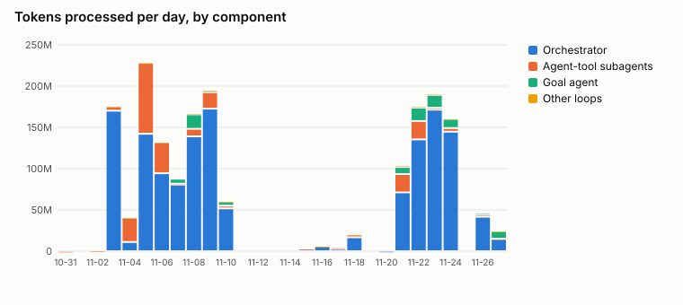
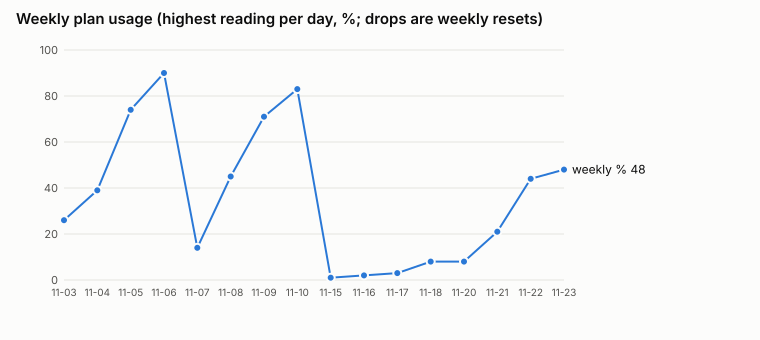
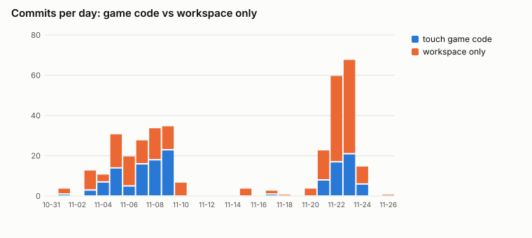
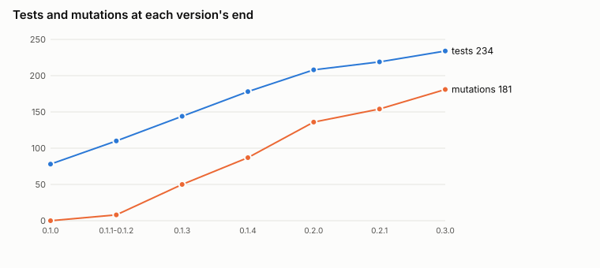
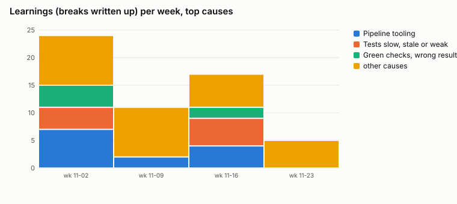

# A7 audit data (generated by `_tools/audit_data.py`; do not edit by hand)

Generated 2026-11-22. Runs logged: 765 (703 with timestamps; the rest, mostly pre-ICM and content runs, count in the totals but not in the per-day or per-version windows). A run counts on the day and in the version where it ended; a main session is one row, so a long session lands as one spike (the 10-31 to 11-03 session, 170M, sits on 11-03).

## Per version

| version | built | dates | days | commits | game lines | tool lines | doc lines | tests | mutations | agent calls | tokens | orch. tokens | play-test findings |
|---|---|---|---|---|---|---|---|---|---|---|---|---|---|
| Design | GDD, two review rounds, proposals | 2026-10-14 to 2026-11-01 | 19 | 46 | 68 | 2210 | 11084 | 0 | 0 | 4 | 926k | 0 | n/a |
| 0.1.0 | Prototype 0, 0.1 Harvest | 2026-11-01 to 2026-11-04 | 3 | 18 | 16365 | 895 | 1842 | 78 | 0 | 19 | 239M | 181M | 6 |
| 0.1.1-0.1.2 | play-test fixes, bottling and sale | 2026-11-04 to 2026-11-05 | 1 | 9 | 13772 | 652 | 233 | 110 | 8 | 12 | 46M | 0 | n/a |
| 0.1.3 | farm layouts, camera stops | 2026-11-05 to 2026-11-06 | 1 | 18 | 5107 | 1769 | 1515 | 144 | 50 | 71 | 195M | 142M | 4 |
| 0.1.4 | UI placement (A5, first goal-agent run) | 2026-11-06 to 2026-11-08 | 2 | 85 | 5719 | 3608 | 4754 | 178 | 87 | 158 | 366M | 318M | 13 |
| 0.2.0 | first automation (goal agent) | 2026-11-08 to 2026-11-09 | 1 | 42 | 12828 | 672 | 1534 | 208 | 136 | 79 | 189M | 169M | 6 |
| 0.2.1 | 0.2.0 play-test fixes (A6) | 2026-11-09 to 2026-11-22 | 13 | 44 | 1578 | 4663 | 3814 | 219 | 154 | 171 | 284M | 221M | 1 |
| 0.3.0 | course build items 1-6 | 2026-11-22 to 2026-11-22 | 1 | 56 | 1868 | 382 | 986 | 234 | 181 | 116 | 85M | 66M | 4 |

Lines are added + deleted, excluding generated reports, CSV, JSON and images. Tests count `func t_` in `game/tests` at the end commit; mutations count entries in `tests/mutations.json`. Findings sources: 0.1.0: 0.1.1-playtest-fixes.md, items 1-6; 0.1.1-0.1.2: not itemised (fixed inside 0.1.3); 0.1.3: 0.1.4-ui-placement.md items 2, 3, 4, 7; 0.1.4: 0.1.4-ui-placement.md items 9-17, 19-22; 0.2.0: 0.2-first-automation.md items 9-14 (0.2.1); 0.2.1: 0.2-first-automation.md item 15; 0.3.0: 0.3.1-playtest-fixes.md items 1-3 (four findings, L52).

## Goal-agent runs

| run | agent calls | tokens | per call | agent time | designer stops |
|---|---|---|---|---|---|
| 0.1.4 | 95 | 24M | 250k | 241 min | 8 |
| 0.2 | 80 | 20M | 253k | 60 min | 13 |
| 0.3 | 71 | 12M | 163k | 33 min | 20 |

Agent time is the sum of the calls' durations, not wall-clock (scripts and waiting are extra). Stops count the board's "Waiting for the designer" sections.

## Mutation testing

Across every logged `mutate:` line in the goal boards and build reports: 46 of 69 mutations caught (67%). A surviving mutation sent its test back for a fix round, so the final state is all caught.

## Learnings per week by cause

| week of | Pipeline tooling | Tests slow, stale or weak | Environment | Agents outside brief | Green checks, wrong result | Process and human loop | Design canvas | Cost blowups | total |
|---|---|---|---|---|---|---|---|---|---|
| 2026-11-02 | 7 | 4 | 1 | 2 | 4 | 4 | 0 | 2 | 24 |
| 2026-11-09 | 2 | 0 | 0 | 2 | 0 | 1 | 5 | 1 | 11 |
| 2026-11-16 | 4 | 5 | 5 | 1 | 2 | 0 | 0 | 0 | 17 |

## Charts

Daily numbers behind the charts: `data/daily.csv`.
